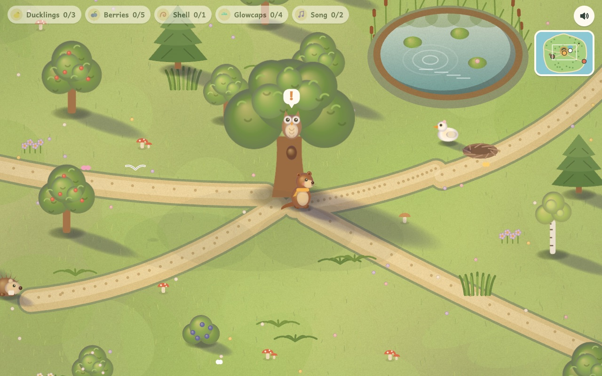
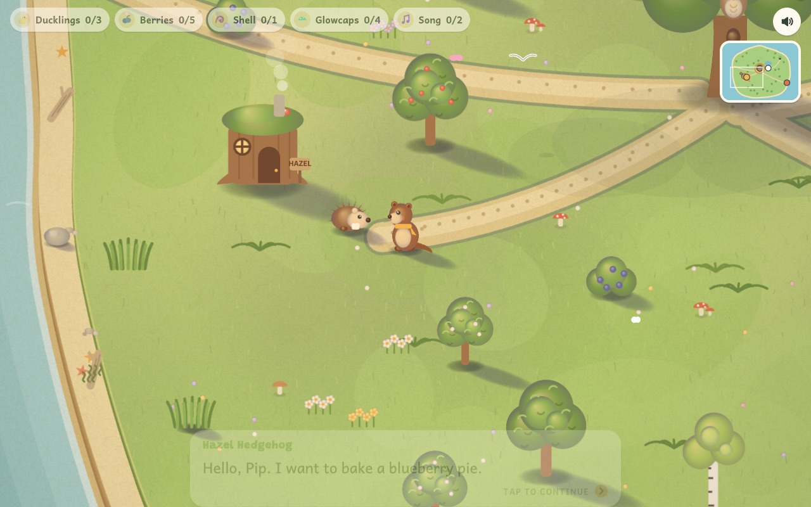
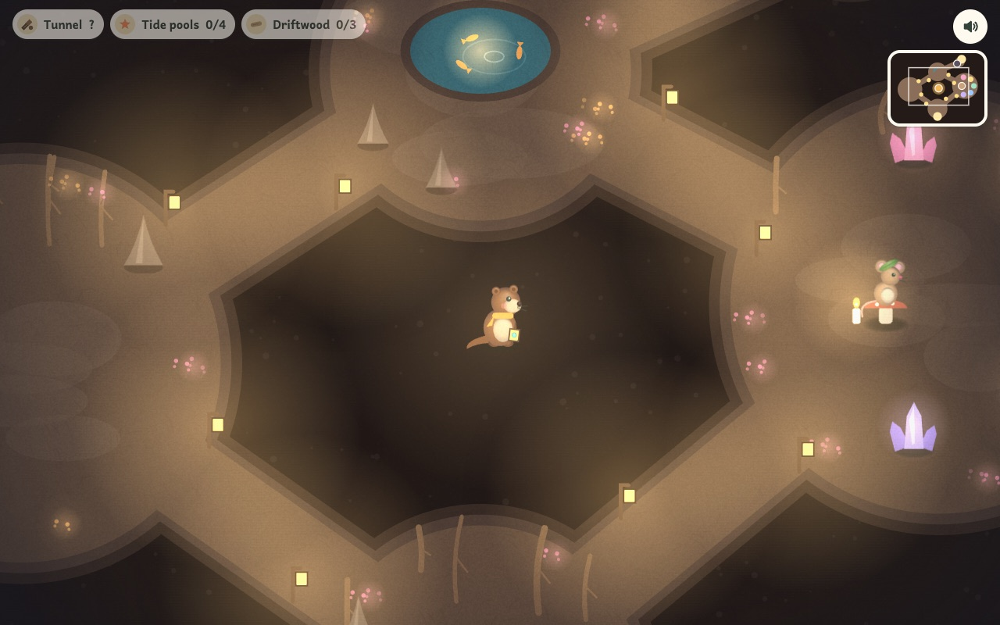
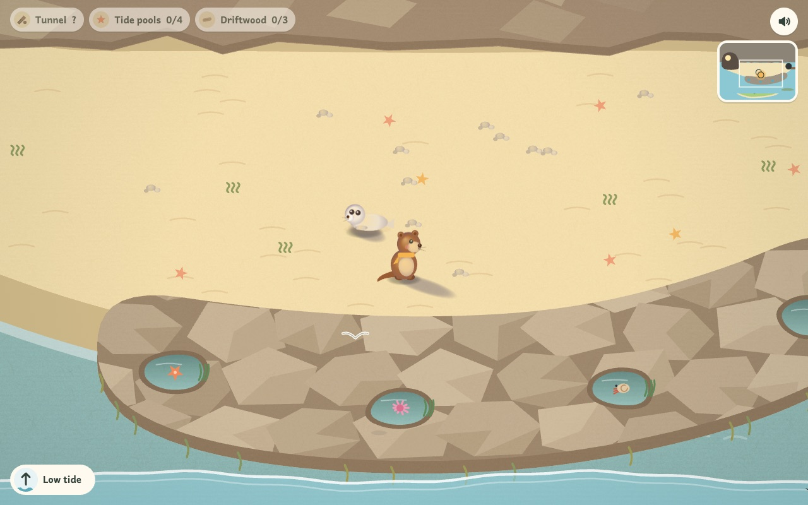
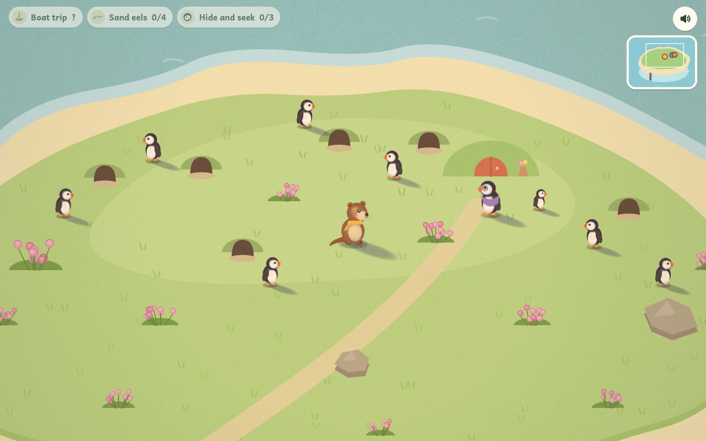

<h1 align="center">Pip's Island</h1>

<p align="center"><b>A cozy little island adventure about a curious otter and the friends he helps.</b></p>

<p align="center">
  <a href="https://marcrleonard.github.io/Pips-Island/"><b>▶ Play it in your browser</b></a>
  &nbsp;·&nbsp; works on phones, tablets and computers
</p>

<p align="center"></p>

Pip the otter wakes up on a sunny island where every friend has something small they need: lost ducklings,
blueberries for a pie, a shell that went missing. Wander, explore, chat, and help out. There's nothing to lose,
no timers and no way to fail, just a gentle, cozy world to poke around in. Every line is read aloud, so the game
works for players who are still learning to read.

## Three days on the island

<table>
  <tr>
    <td width="50%"></td>
    <td width="50%"></td>
  </tr>
  <tr>
    <td><b>Day 1 · The island and the Burrow.</b> Bramble the Owl suggests one friend at a time. Find Mama Duck's
    ducklings, pick berries for Hazel, return Grandpa Crab's shell, collect glowcaps for Digby Mole and learn
    Fern Mouse's crystal song.</td>
    <td><b>Under the island.</b> Digby's burrow lights up with lanterns once his glowcaps are home, and he starts
    digging a tunnel toward the sea.</td>
  </tr>
  <tr>
    <td></td>
    <td></td>
  </tr>
  <tr>
    <td><b>Day 2 · Seagrass Cove.</b> Digby's tunnel opens onto a hidden beach. Watch the tide: peek in the tide
    pools for Pearl the seal pup when the water is low, and gather driftwood for Captain Puff's boat when it washes
    in.</td>
    <td><b>Day 3 · Puffin Isle.</b> Sail across with Captain Puff. Catch leaping sand eels for Nana Puff's hungry
    pufflings, and play hide and seek with little Pebble.</td>
  </tr>
</table>

## What makes it nice

- **Cozy by design.** No fail states, no timers, no scores. Friends point you to the next thing one gentle hint at a time.
- **Fully voiced.** Every character has their own voice, and every line is recorded.
- **Tap to walk.** Pip finds his own way around trees, ponds and rocks. Arrow keys and WASD work too.
- **Picks up where you left off.** Progress saves automatically in the browser.
- **Painted in code.** No image files: soft, lit, cut-paper shapes drawn with Canvas 2D, running at 60 fps on phones.
- **One file.** The whole game builds into a single HTML page, so it's easy to host or share.

## Quick start

```sh
python3 tools/build.py          # writes dist/pips-island.html (open it in a browser)
python3 tools/watch.py          # rebuild on every save + serve at http://localhost:8000/pips-island.html
```

Open the game with `#day2` or `#day3` at the end of the URL to skip straight to that day.

Progress saves automatically in the browser (`localStorage`) as a small JSON document; see AGENTS.md for its shape.

## Layout

```
src/shell.html              page markup and CSS; the build inserts the scripts at <!--SCRIPTS-->
src/engine/                 reusable engine: canvas setup, audio and voices, dialog box,
                            input and camera, tap-to-walk pathfinding, main loop
src/render/style.js         the art style: shaded volumes, shadows, color grade, baked ground, pose cache
stories/pips-island/        everything specific to this story
  story.json                quests (order, day, owner, HUD label), item pictures, end cards
  script.json               every spoken line, with stable ids and voice directions
  cast.json                 speakers: names, browser-voice tuning, Fish Audio voice ids, acting notes
  *.js                      scene layouts, quest logic and art (island, burrow, cove, characters)
audio/                      voice files and the manifest the game reads
tools/                      build, watch, voice tools, art lab
```

`tools/order.txt` lists the script files in load order. The build wraps them in one function scope, so files
share names without polluting the page.

## Voices

Every line in `script.json` has an `id`, a `speaker`, on-screen `text`, and a `direction` like
`[warm, gently suggesting]`. The recording for a line lives at:

```
audio/voice/<speaker>/<line id>.mp3        e.g. audio/voice/owl/owl.hint.duck.mp3
```

The game plays a recording when `audio/manifest.json` lists it and falls back to the browser's voice otherwise,
so you can record a few lines at a time.

**With Fish Audio:**

1. Get a key at https://fish.audio/app/developers/get-started/ and add credit at
   https://fish.audio/app/developers/billing/ (pay as you go). Then `export FISH_API_KEY=...`, or put it in a `.env`
   file at the project root (`.env` is git-ignored).
2. Every character already has a voice from Fish's public library in `cast.json`
   (`speakers.<id>.fish.reference_id`, with a `voice` note naming it). To recast, paste another model id there.
3. `python3 tools/fish_tts.py --audition` makes one line per character so you can hear the cast, then
   `python3 tools/fish_tts.py` makes the rest (`--dry-run` previews what would be sent). New files are leveled
   to -19 LUFS with ffmpeg, because Fish's raw output is loud enough to sound harsh on phone speakers.
4. `python3 tools/build.py`.

`fish_tts.py` sends `"<direction> <text>"` to `POST https://api.fish.audio/v1/tts` with model `drama-3` by default,
Fish's model for acted character voices, which reads free-form cues in square brackets. `--model s2.1-pro-free` is
free for testing; `--model s2.1-pro` is the general-purpose model. It remembers what it sent in `audio/voice_hashes.json`, so later runs
only regenerate lines whose words, direction or voice changed. Options: `--only owl,pip`, `--ids 'owl.hint.*'`,
`--force`, `--limit N`.

**With anything else:** `tools/tts_batch.py --cmd '...'` runs any command line per missing line (examples for macOS
`say` and Piper are in the file). `tools/voice_lines.py` writes `audio/voice_lines.csv`, a recording sheet with
every line, its direction, character notes and file name, and refreshes the manifest.

**Writing lines:** change text freely, but give new words a new id rather than reusing an old one. Numbers that
change during play ("You have three blueberries") are written as one line per value (`hog.progress.0` … `.4`), so
every line can be recorded ahead of time.

## Making another story

Copy `stories/pips-island` to `stories/<new-story>`, replace the JSON files and scene code, and point
`tools/build.py` (the `story_dir` variable) and `tools/order.txt` at it. The engine files don't need to change.
See AGENTS.md for how the pieces fit and what is still story-specific.

## Porting to another engine

The JSON files (`story.json`, `script.json`, `cast.json`, `audio/manifest.json`) are engine-neutral and can be loaded
as-is. The JavaScript is plain functions over a small state object (`S`), so the quest logic in
`stories/pips-island/quests.js` translates almost line for line. On the art side, each `cached(...)` sprite is a static
texture, `styled(...)` is an animated sprite, `bakedGround` is a static background or tile map, and `LOOK` is a light
direction plus a color-grading LUT.

## Hosting

Every push to `main` builds the game and publishes it with its voice files to GitHub Pages
(`.github/workflows/pages.yml`): https://marcrleonard.github.io/Pips-Island/
